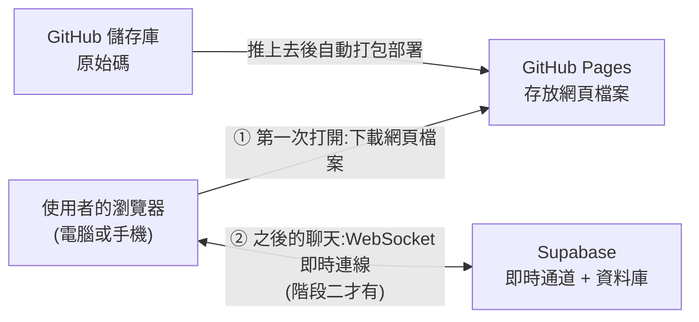
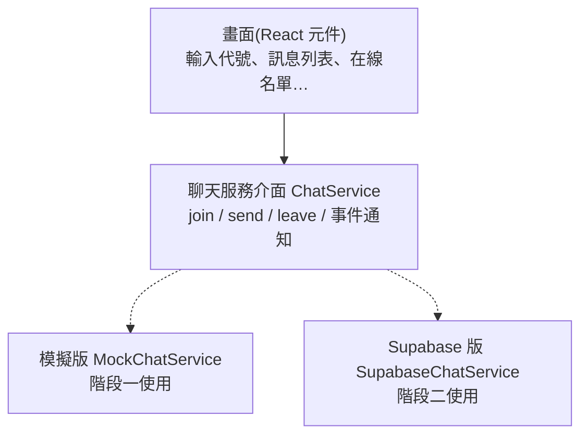
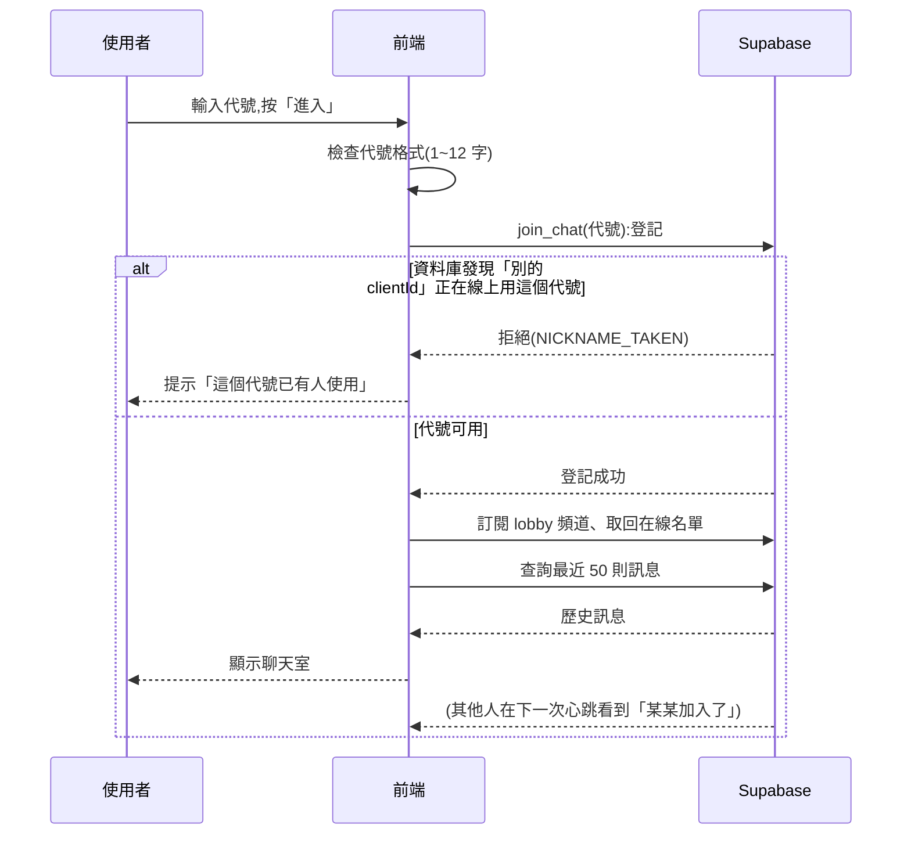
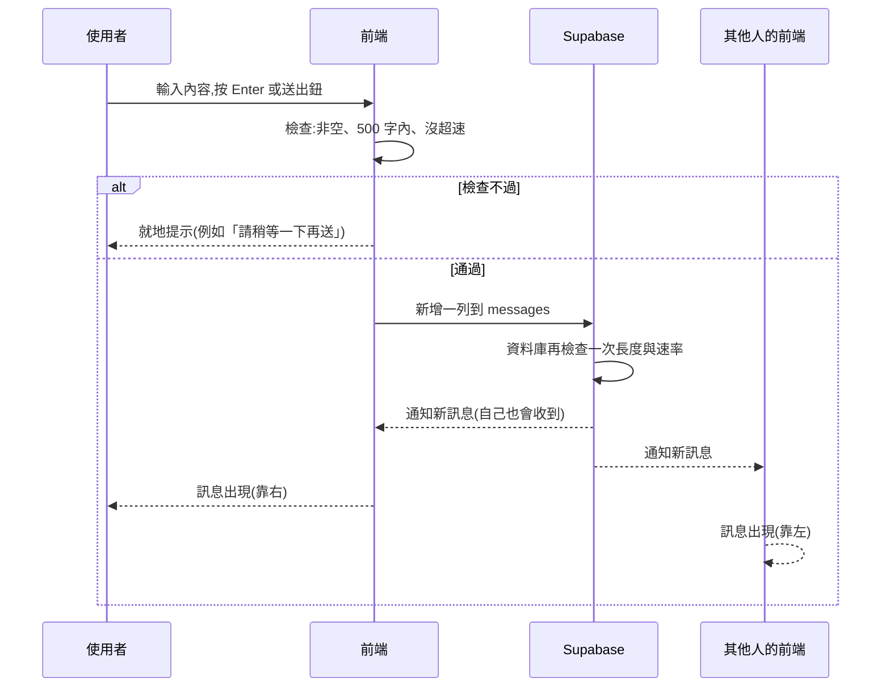
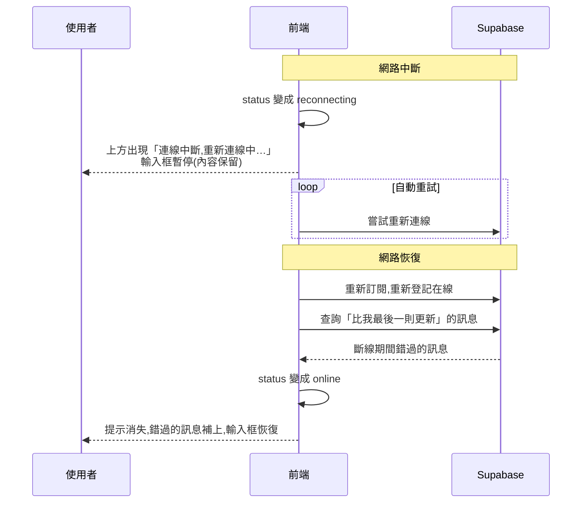

# 匿名聊天室:架構文件

> 這份文件寫給「不是寫程式的人」。專有名詞第一次出現時,會用一句話解釋。
> 需求來源:`docs/requirements.md`,以及事前一問一答確認過的細節(整理在第 7 章與第 10 章)。
> 本文件只描述「要怎麼做」,不包含任何程式碼。

---

## 1. 專案說明與目標

**這是什麼**:一個不用註冊、不用登入的匿名聊天室。任何知道網址的人,輸入一個代號就能進入同一間聊天室,看到大家的訊息,也能送出自己的訊息。電腦和手機都能用。

**目標**

1. 輸入代號就能進來聊天,零門檻。
2. 即時:別人送出訊息、進來、離開,你的畫面馬上跟著變。
3. 畫面上看得到「誰在線上」。
4. 一開始就能在網路上看到成品(GitHub Pages),不必等後端接好。
5. 全部使用免費方案就能運作。

**開發順序(沿用你的決定)**

- **階段一**:先把前端做完,放上 GitHub Pages,用「假資料」就能操作和展示。
- **階段二**:最後才接上 Supabase,變成真的多人即時聊天。

---

## 2. 整體架構圖

先認識三個角色:

- **瀏覽器**:使用者打開網頁的地方(Chrome、Safari 等)。聊天室的畫面和操作邏輯,都在這裡執行。
- **GitHub Pages**:GitHub 提供的免費網頁空間。它只負責「把網頁檔案交給瀏覽器」,自己不處理任何聊天內容。
- **Supabase**:一個現成的後端服務(後端就是「在網路上幫大家保管資料、轉發訊息的那一端」)。聊天內容、在線名單都靠它。



**怎麼讀這張圖**

- 步驟 ① 只發生一次:瀏覽器從 GitHub Pages 拿到網頁。之後 GitHub Pages 就不參與了。
- 步驟 ② 是聊天本身:瀏覽器直接和 Supabase 連線。**WebSocket** 是一種「連線一直保持著,雙方隨時可以主動傳東西」的網路方式,所以別人一發言,你的畫面就立刻更新,不需要重新整理。
- 階段一沒有步驟 ②,聊天內容由瀏覽器裡的「模擬器」假裝產生(見第 4 章)。

---

## 3. 技術選擇

### 3.1 前端

| 項目 | 選了什麼 | 為什麼 |
|---|---|---|
| 語言 | **TypeScript** | 它是 JavaScript(瀏覽器唯一能直接執行的程式語言)加上「型別檢查」:資料格式寫錯時,在存檔當下就會被抓出來,而不是等使用者遇到才發現。第 5 章的訊息格式就是靠它來把關。 |
| 框架 | **React** | 框架是「別人寫好的程式骨架」。聊天室的畫面會一直變動(新訊息、人進出、斷線提示),React 的做法是「資料變了,畫面自動跟著更新」,比手動改畫面不容易出錯。它也是 `/frontend-design` 最常產出的形式。 |
| 打包工具 | **Vite** | 打包工具把我們寫的多個檔案整理成瀏覽器能讀的幾個檔案。Vite 設定少、速度快,而且官方有支援部署到 GitHub Pages 的子路徑。 |
| 樣式 | 一般 **CSS**(含 CSS 變數) | 亮色與暗色外觀只要換一組變數即可,並用 `prefers-color-scheme` 自動跟隨系統設定。具體顏色、字體交給 `/design`。 |

不選的替代方案:

- 純 HTML 加手寫 JavaScript:檔案少、很簡單,但這個專案有「在線名單、重新連線、捲動位置」等多種會互相影響的狀態,手寫容易亂。
- Next.js 等需要伺服器的框架:GitHub Pages 只能放靜態檔案(不會在伺服器上執行任何程式的檔案),用不到它們的功能。

### 3.2 Supabase 的哪些功能

Supabase 提供很多功能,這個專案**只用以下兩個**:

| 功能 | 用來做什麼 | 為什麼選它 |
|---|---|---|
| **Database**(資料庫,PostgreSQL) | 保存聊天訊息,讓新來的人能看到最近 50 則;另有一張 `presence` 表加上三個函式,負責「誰在線上」(見 5.3) | 需求要求「新進來的人看得到最近的訊息」,必須有地方存。資料庫還能設規則:訊息長度上限、每人發言速率、7 天自動清除(見 9.3)。 |
| **Realtime Postgres Changes**(資料庫變更即時通知) | 有人送出訊息時,通知所有在線的人 | 訊息「寫進資料庫」和「通知大家」是同一個動作:只要成功寫入,所有人就收到。不會出現「通知了但沒存到」或「存了但沒人收到」的不一致。 |

**刻意不用的功能**

- **Supabase Auth(登入系統)**:需求明說不要登入。
- **Storage(檔案儲存)**:不支援圖片和檔案。
- **Edge Functions(在 Supabase 上跑自訂程式)**:第一版用資料庫規則就夠了,少一個東西就少一個出錯和被收費的可能。
- **Realtime Presence(即時在線狀態)**:原本用它做在線名單,但實測多人幾乎同時進入時,伺服器端的頻道偶爾會崩潰,登記要卡 10 秒,名單常常不同步(當時 Supabase 也有 Realtime 的事件公告)。改成「資料表 + 心跳」:每個人每 3 秒呼叫一次伺服器函式報到並取回名單,15 秒沒報到就算離開。代價是名單最多慢 3 秒更新、每人每 3 秒一個請求;好處是不依賴 Realtime,而且代號重複由資料庫排隊判斷,同一瞬間同名也一定只有一人成功。
- **Broadcast(只轉發、不存檔的即時訊息)**:不選它做聊天訊息,因為它不會存檔,新進來的人看不到歷史。

### 3.3 其他

| 項目 | 選了什麼 | 為什麼 |
|---|---|---|
| 部署 | **GitHub Actions** → GitHub Pages | Actions 是 GitHub 的自動化功能,你把程式推上去,它會自動打包並發布,不用手動上傳。 |
| 套件管理 | **npm** | 「套件」是別人寫好、可以直接拿來用的功能包。npm 是 Node.js 內建的套件管理工具,不用另外安裝。 |

---

## 4. 兩個階段,以及如何不重寫

### 4.1 設計原則:前端只認「聊天服務介面」

前端程式碼**不直接**和 Supabase 說話。中間隔一層「聊天服務介面」(**介面**就是一份約定:「我需要你提供這些功能」,至於功能怎麼實現,前端不管)。



- 畫面只對著「介面」寫,完全不知道背後是模擬還是真的。
- 階段一寫 `MockChatService`,階段二新增 `SupabaseChatService`,**畫面程式一行都不用改**。
- 用哪一版,由一個「環境開關」決定(見第 8 章):網址和公開金鑰**都有填**才用 Supabase 版;沒填就自動用模擬版,只填其中一個會在控制台警告並使用模擬版。

### 4.2 階段一:只有前端,放上 GitHub Pages

**能做到什麼程度**:所有畫面和操作都完整可用。

- 完整的畫面:輸入代號、聊天室、在線名單、斷線提示、「有新訊息」按鈕、分頁標題未讀數、亮暗色外觀、手機版面。
- 模擬版聊天服務在瀏覽器裡假裝是「真的聊天室」:
  - 內建幾個**機器人使用者**,會定時進出、說話,所以你一進去就看到「有人在線、有人講話」。
  - 代號重複會被擋(和機器人撞名時)。
  - 防洗版、500 字上限、斷線重連都會模擬。
  - 可以用網址參數(例如 `?simulate=offline`)手動觸發「斷線」,用來檢查斷線畫面。
- **同一台電腦開兩個分頁**,兩邊可以真的互相對話(用瀏覽器內建的 `BroadcastChannel`:同一個瀏覽器的不同分頁之間可以互傳訊息的功能)。這樣你不用接後端,也能自己扮演兩個人測試。
- 訊息暫存在瀏覽器的 `localStorage`(瀏覽器替每個網站保留的一小塊本機儲存空間),重新整理還看得到最近 50 則。

**怎麼在 GitHub Pages 上看到**:見第 12 章。階段一完全不需要任何金鑰。

**階段一的限制**(要先知道,以免誤會):不同人、不同裝置之間**無法**真的對話。這是預期中的,階段二才會解決。

### 4.3 階段二:接上 Supabase

**要做的事**

1. 在 Supabase 建立專案,建立 `messages` 資料表和安全規則(第 9 章)。
2. 新增 `SupabaseChatService`,實作和模擬版相同的介面。
3. 把網址與公開金鑰填入環境設定(第 8 章)。
4. 重新部署。

**使用者看到的改變**:機器人消失,在線名單變成真人;不同裝置之間真的能對話;訊息保存在資料庫(最多 7 天)。

**程式的改變**:只有新增一個檔案、改一個「選哪一版服務」的開關。畫面不動。

### 4.4 兩個階段共用的部分

- 第 5 章的訊息格式:兩版服務送出、收到的資料長得一模一樣。
- **輸入檢查的函式**(代號、訊息內容的檢查規則)放在共用位置,前端兩版都用,資料庫規則也寫成相同標準(第 9 章)。

---

## 5. 通訊約定

### 5.1 資料格式

**訊息(Message)**

| 欄位 | 意思 | 規則 |
|---|---|---|
| `id` | 訊息的唯一編號 | 由資料庫自動產生 |
| `createdAt` | 送出時間 | 由資料庫以**伺服器時間**自動填入,不信任使用者電腦的時鐘 |
| `clientId` | 這個分頁的隨機識別碼 | 分頁第一次打開時隨機產生,存在 `sessionStorage`(重新整理不變,但每個分頁是不同的「人」,同一台電腦開兩個分頁才能扮演兩個人);用來分辨「這則是不是我送的」(靠右顯示)和做防洗版。**不是登入身分**,可以被偽造。 |
| `nickname` | 發言者代號 | 1 到 12 字 |
| `content` | 訊息內容 | 1 到 500 字,純文字 |

**在線成員(Member)**

| 欄位 | 意思 |
|---|---|
| `clientId` | 同上 |
| `nickname` | 代號 |
| `joinedAt` | 進來的時間 |

### 5.2 事件名稱

前端內部統一用以下事件(兩版服務都要發出同樣的事件):

| 事件名稱 | 何時發生 | 帶什麼資料 |
|---|---|---|
| `message` | 有一則新訊息(包括自己送出的) | Message |
| `members` | 在線名單有變動 | Member 的完整清單 |
| `member_joined` | 有人加入(已排除 10 秒內重連) | Member |
| `member_left` | 有人離開(已排除 10 秒內重連) | Member |
| `status` | 連線狀態改變 | `connecting`(連線中)、`online`(已連線)、`reconnecting`(重新連線中) |

前端主動呼叫的動作:

| 動作 | 說明 | 結果 |
|---|---|---|
| `join(nickname)` | 進入聊天室 | 成功(附帶最近 50 則訊息),或失敗:`NICKNAME_TAKEN`(代號被用)、`INVALID_NICKNAME`(格式不合) |
| `send(content)` | 送出訊息 | 成功,或失敗:`INVALID_CONTENT`、`RATE_LIMITED`(太頻繁)、`OFFLINE`(目前斷線) |
| `leave()` | 離開聊天室 | 無 |

### 5.3 階段二在 Supabase 上的對應

| 前端事件 | Supabase 上實際的東西 |
|---|---|
| 聊天室 | 一個叫 `lobby` 的 Realtime 頻道(**頻道**是「同一群人訂閱同一個主題」的概念),只用來即時收新訊息。另外每 6 秒補查一次,頻道暫時有狀況時也不會漏訊息 |
| 在線名單 | `public.presence` 資料表(不開放給公開金鑰直接讀寫),只能透過函式操作:`join_chat`(登記代號,同名且對方在線就拒絕)、`chat_tick`(心跳並取回名單,每 3 秒一次;15 秒沒心跳就算離開)、`leave_chat`(主動離開) |
| `message` | 對 `public.messages` 資料表的 `INSERT`(新增一列)通知 |
| 歷史訊息 | 查詢 `messages`,依 `created_at` 由新到舊取 50 筆,再反轉成由舊到新 |

---

## 6. 資料流

### 6.1 進入聊天室



重點:

- 代號會存進瀏覽器,下次打開時預先填好,但仍要按「進入」(你的決定)。
- 同一個 `clientId` 用同一個代號是被允許的。這樣重新整理或是手機切換 App 後回來,不會被「自己的殘影」擋在門外。
- 兩個人在同一瞬間用同名代號進入:資料庫用鎖讓兩個請求排隊處理,**先到的成功,後到的被拒絕**並看到「代號已有人使用」。

### 6.2 送出訊息



重點:

- 自己的訊息是等資料庫寫入成功、用寫入的回傳結果顯示(不必等 Realtime 通知),所以「畫面上看到 = 確定已存進去」。其他人則透過 Realtime 通知,或 6 秒內的補查收到。
- 如果被資料庫拒絕(例如速率),前端顯示失敗提示,輸入框內容保留,讓使用者不用重打。

### 6.3 離開

- **主動離開**(按離開鈕):前端呼叫 `leave()`,資料庫立刻把他標成離線,其他人在下一次心跳(3 秒內)看到他消失。
- **直接關掉分頁或瀏覽器**:頁面關閉的瞬間會盡量送出離開通知;來不及也沒關係,15 秒沒有心跳,名單就會自動把他移除。
- **手機切到背景**:系統可能暫停心跳。切回來時前端立刻補一次心跳;如果名單裡找不到自己,會自動重新登記。
- 其他人的畫面會等待 **10 秒**再顯示「離開」。這 10 秒內如果同一個 `clientId` 又回來,就**不顯示**任何提示(手機切換 App 不會洗版)。

### 6.4 斷線重連



重點:

- Realtime 頻道的重連是 Supabase 的函式庫自動做的;名單靠心跳,每 3 秒自然就補齊。連回來之後我們另外補查訊息。
- 狀態條的依據是「心跳連續失敗 2 次,或瀏覽器回報離線」。Realtime 頻道暫時斷開不會跳出斷線條,因為送訊息和補查都不靠它。
- 補訊息的依據是「畫面上最後一則訊息的 `createdAt`」,以免重複或漏掉。
- 如果斷線超過 15 秒,他會被視為離開;重連後的下一次心跳會自動重新登記,並依 6.3 的規則,若在 10 秒內回來則不顯示提示。

---

## 7. 畫面清單

只描述「有什麼、做什麼」,顏色、字體、間距、動畫由 `/design` 決定。

### 7.1 畫面 A:進入畫面

| 元素 | 行為 |
|---|---|
| 標題與一句簡短說明 | 純顯示 |
| 代號輸入框 | 如果瀏覽器記得上次的代號,預先填入。限制 1~12 字,超過就無法再輸入;即時顯示字數。 |
| 「進入」按鈕 | 代號合格才可按。按下後顯示「進入中…」並暫時不能重複按。 |
| 錯誤提示 | 代號被使用:「這個代號已有人使用,請換一個」;代號格式不合:說明哪裡不合;連線失敗:顯示「聊天室暫時無法使用,請稍後再試」(見 9.4)。 |
| 目前人數 | 顯示「目前 N 人在線」,讓人知道有沒有人在。階段一的模擬版也會顯示;取不到人數時整個提示不顯示。 |

### 7.2 畫面 B:聊天室

**B1. 標題列**

| 元素 | 行為 |
|---|---|
| 聊天室名稱 | 純顯示 |
| 在線人數 | 顯示「N 人在線」 |
| 「在線名單」按鈕 | **只在手機版出現**,點了展開名單(見 B3) |
| 「離開」按鈕 | 點了回到畫面 A,代號仍保留預先填好 |

**B2. 訊息區(可捲動)**

| 元素 | 行為 |
|---|---|
| 一般訊息 | 顯示代號、內容、時間(只有時和分,如 14:32)。每個代號對應固定的顏色(同一個名字永遠同色)。內容中的網址(http 或 https 開頭)變成可點的連結,點了在新分頁開啟。 |
| 自己的訊息 | 靠右、底色不同;別人的靠左。 |
| 日期分隔線 | 跨日時插入一條,例如「2026 年 10 月 13 日」。 |
| 系統提示行 | 灰色小字,例如「小明 加入了聊天室」、「小明 離開了聊天室」。跟著訊息一起往上捲動。只在你**在線期間**發生的才會顯示(見第 10 章)。 |
| 載入中 / 空狀態 | 載入歷史時顯示載入中;沒有任何訊息時顯示「還沒有人說話,來說第一句吧」。 |
| 捲動行為 | 你本來停在最底,或是你剛送出自己的訊息:自動捲到底。你正往上翻舊訊息:畫面不動,右下角出現「有新訊息 ↓」按鈕,點了才回到最底並消失。 |

**B3. 在線名單**

| 元素 | 行為 |
|---|---|
| 名單 | 每人一列,顯示代號(與其代表色);自己的代號後面加「(你)」。 |
| 電腦版 | 固定的側邊欄,永遠看得到。 |
| 手機版 | 平常收起;點標題列的按鈕後展開成面板,可關閉。 |

**B4. 輸入區**

| 元素 | 行為 |
|---|---|
| 輸入框 | 最多 500 字,輸入框下方一直顯示「已輸入字數 / 500」。電腦版:**Enter 送出,Shift+Enter 換行**。手機版:Enter 是換行。 |
| 「送出」按鈕 | 內容為空(只有空白也算空)時不能按。手機版靠它送出。 |
| 超速提示 | 5 秒內送超過 3 則時顯示「請稍等一下再送」,內容保留。 |

**B5. 連線狀態條**

| 元素 | 行為 |
|---|---|
| 頂部提示條 | 只在斷線時出現:「連線中斷,重新連線中…」。出現時輸入框暫停。連回來後自動消失。 |

**B6. 分頁標題**

- 分頁在背景時,每來一則別人的訊息就累計:「(3) 匿名聊天室」。切回該分頁就歸零。

### 7.3 全域行為

- **外觀**:自動跟隨系統的亮色/暗色設定,沒有切換按鈕。
- **語言**:只有繁體中文。
- **手機版面**:輸入框固定在最下方,手機的虛擬鍵盤跳出時不能蓋住輸入框;所有按鈕大小要好點。
- **無障礙**:新訊息要能被螢幕閱讀器朗讀(`aria-live`),按鈕要有文字標籤,鍵盤可以操作所有功能。

---

## 8. 金鑰

### 8.1 這個專案會碰到的金鑰

| 名稱 | 是什麼 | 能公開嗎 |
|---|---|---|
| **Supabase 專案網址**(Project URL) | 你的 Supabase 專案在網路上的位置 | ✅ 可以公開 |
| **Publishable key**(公開金鑰;舊版後台叫 `anon key`) | 讓瀏覽器能連上 Supabase 的「入場券」。權限很低,**能做什麼完全由資料庫的安全規則(RLS)決定**。 | ✅ 可以公開(它本來就會出現在網頁原始碼裡,藏不住) |
| **Secret key**(秘密金鑰;舊版叫 `service_role key`) | 萬能鑰匙,**無視**所有安全規則,可以讀寫刪除任何資料 | ❌ **絕對不能公開** |
| **資料庫密碼**(Database password) | 建立專案時設定的密碼,可以直接連進資料庫 | ❌ **絕對不能公開** |
| **GitHub 個人存取權杖**(若你之後用到) | 代表你的 GitHub 帳號的密碼 | ❌ **絕對不能公開** |

**一句話原則**:這個專案**只需要**「專案網址」和「公開金鑰」。前端、GitHub、GitHub Actions 的設定裡,**一律不放**秘密金鑰和資料庫密碼。

> **RLS(Row Level Security,資料列安全規則)**是資料庫內建的門禁:規定「誰可以對哪些資料做什麼事」。第 9 章會說明它如何保護你。**公開金鑰之所以可以公開,完全是因為有 RLS 擋著。** 所以 RLS 一定要設,而且要先測過再公開網址。

### 8.2 怎麼產生

1. 到 supabase.com,用 GitHub 或 Email 註冊並建立專案(選離使用者近的區域,例如東京或新加坡)。建立時會要你設定資料庫密碼,**用密碼管理器存起來**。
2. 專案建好後,到 **Project Settings → API Keys**(或 Data API 頁面):
   - **Project URL**:複製。
   - **Publishable key**:複製。
   - 同一頁也會看到 **Secret key**,**不要複製、不要貼到任何地方**。
3. 這個專案不需要自己「產生」其他金鑰。

### 8.3 放在哪裡

| 場合 | 放法 |
|---|---|
| **你自己的電腦(開發時)** | 專案根目錄建立 `.env.local` 檔,內容是網址和公開金鑰。這個檔案**已被忽略,不會被 commit**。 |
| **範例檔** | 另外有 `.env.example`,只寫變數名稱和空白值,說明要填什麼。**這個會被 commit,也只有這個**。 |
| **GitHub Actions(自動部署時)** | 在 GitHub 儲存庫的 **Settings → Secrets and variables → Actions** 填入網址和公開金鑰,打包時由流程帶入。 |

變數名稱:`VITE_SUPABASE_URL`、`VITE_SUPABASE_PUBLISHABLE_KEY`。名稱開頭的 `VITE_` 是 Vite 的規定:**有這個開頭的變數會被打包進網頁**。這正好提醒你:**任何 `VITE_` 開頭的東西都是公開的**,所以秘密金鑰絕對不能取這種名稱。

**誠實說明**:即使放在 GitHub Secrets 裡,公開金鑰最後還是會被打包進網頁,任何人按右鍵看原始碼都看得到。這是正常且預期的。放 Secrets 只是方便管理,不是為了保密。

### 8.4 怎麼避免被 commit 到 GitHub

1. `.gitignore` 明確列入 `.env`、`.env.local`、`.env.*.local`。**在建立任何金鑰檔之前,先把這個設好。**
2. 只 commit `.env.example`(沒有真實值)。
3. 每次 commit 前用 `git status` 看一眼,確認沒有 `.env*` 出現在要提交的清單。
4. 在 GitHub 儲存庫開啟 **Secret scanning 與 Push protection**(Settings → Code security):如果有人不小心推了疑似金鑰的字串,GitHub 會直接擋下或警告。
5. **萬一洩漏了**:立刻到 Supabase 後台重設(rotate)該金鑰或資料庫密碼。**只刪掉 commit 是不夠的**,因為 Git 歷史裡還找得到,必須視為已經外洩、換新。

---

## 9. 安全與限制

### 9.1 前提:前端的檢查擋不住壞人

前端的檢查(字數、速率)只是為了**使用者體驗**。任何會寫程式的人都可以跳過你的網頁,直接拿著公開金鑰對 Supabase 送資料。所以**真正的防線必須在資料庫**,前端擋是第一層、資料庫擋是第二層。

### 9.2 別人可能送進來的奇怪東西,以及怎麼擋

| 可能的情況 | 前端的處理 | 資料庫(階段二)的處理 |
|---|---|---|
| 超長訊息 | 輸入框限制 500 字,超過不能送 | 資料表規則 `CHECK`:長度 1~500,否則拒絕寫入 |
| 空白訊息(只有空白或換行) | 去掉頭尾空白後為空就不能送 | `CHECK`:去空白後長度 ≥ 1 |
| 超長或空的代號 | 限制 1~12 字 | `CHECK`:長度 1~12 |
| **惡意 HTML / 腳本**,例如在訊息裡塞 `<script>` 或 ``(這叫 **XSS**:讓別人的瀏覽器執行你塞進去的程式碼) | React 預設把所有內容當純文字顯示,**不當成 HTML**。規定:**專案裡禁止使用 `dangerouslySetInnerHTML`**;網址轉連結用「拆成片段、逐段以元件渲染」的方式,不用字串拼 HTML。 | 不處理(儲存原樣文字即可,因為顯示端已安全) |
| **危險連結**,例如 `javascript:` 開頭的網址 | 只把 `http://` 和 `https://` 開頭的轉成連結;連結一律加 `rel="noopener noreferrer"` 並在新分頁開啟 | — |
| **看不見的字元、方向控制字元**(可用來偽裝文字、讓訊息排版錯亂) | 送出前移除控制字元(零寬字元、RTL/LTR 覆寫字元等)。代號和內容都做。 | 同樣用規則檢查,拒絕含有這些字元的內容 |
| **冒充**:取名「系統」、「管理員」,或在代號裡塞很多空白讓它看起來像別人 | 代號會去掉頭尾空白、連續空白合併成一個;禁用「系統」、「管理員」、「admin」等保留字 | 同樣的檢查規則 |
| **洗版**:短時間送大量訊息 | 每人每 5 秒最多 3 則,超過時禁止送出並提示 | 資料庫有一個「觸發器」(寫入前自動執行的檢查):同一個 `clientId` 在 5 秒內已有 3 則就拒絕寫入 |
| **直接對 API 亂送**(跳過網頁) | — | RLS:`messages` 只允許「讀取」和「新增」,**禁止修改、禁止刪除**。其他資料表一律不開放。 |
| **偽造別人的 `clientId`** | — | **無法完全防止**,因為沒有登入就沒有可靠的身分。這是匿名聊天室的先天限制(見第 10 章)。 |
| 用多個 `clientId` 繞過速率限制 | — | 無法完全防止,只能靠 Supabase 本身的流量限制擋大宗濫用。 |

### 9.3 資料保存

- 訊息保留 **7 天**。資料庫每天執行一次清除工作,刪掉超過 7 天的訊息(使用 Supabase 內建的排程功能 `pg_cron`)。
- 使用者不能刪除或編輯自己的訊息。

### 9.4 免費方案的上限(階段二要注意)

以下數字是撰寫時的大致數值,**Supabase 會調整方案,請以官方的定價頁和後台為準**,在階段二開始時重新確認一次。

| 項目 | 大約上限 | 對這個專案的影響 |
|---|---|---|
| **閒置暫停** | 一段時間(約 1 週)沒有任何使用,專案會被**暫停** | 聊天室久沒人用,下次打開會連不上。要到後台手動按「恢復」。**這是最容易踩到的地雷。** |
| 同時連線數 | 約 200 | 同時超過這個人數,多出來的人連不上。 |
| 即時訊息量 | 每秒訊息數與每月訊息總數都有上限 | 聊天室很熱絡時可能碰到。 |
| 資料庫大小 | 約 500 MB | 純文字、只存 7 天,幾乎不可能用完。 |
| 流量(頻寬) | 每月有上限 | 每次進入都會載入 50 則歷史,人多時會累積,但純文字很小。 |
| GitHub Pages | 每月流量有軟性上限、網站大小有限 | 網頁很小,幾乎不會碰到。 |

**碰到上限時,前端應該怎麼表現**:顯示「聊天室暫時無法使用,請稍後再試」,而不是讓畫面空白或一直轉圈。

---

## 10. 這一版刻意不做的事

| 不做 | 為什麼 |
|---|---|
| 註冊、登入 | 你的需求明確不要。代價:無法可靠辨識「是誰」(見 9.2) |
| 圖片、檔案上傳 | 匿名又不用登入,上傳功能最容易被濫用,也會吃光免費額度 |
| 檢舉、封鎖、管理員 | 沒有登入就無法真正封鎖一個人,做了也容易被繞過。先只做防洗版,之後有需要再議 |
| 刪除或編輯自己的訊息 | 沒有登入,系統無法確認「這則是不是你送的」 |
| 提示音 | 人多時會很吵;改用分頁標題未讀數 |
| 切換語言、手動切換亮暗色 | 使用者都是中文使用者;亮暗色自動跟隨系統,少一個按鈕少一份維護 |
| 私訊、多個房間 | 需求是「所有人在同一個聊天室」 |
| 顯示「正在輸入…」 | 需求沒提到,而且會增加即時訊息量,吃免費額度 |
| 訊息永久保存 | 匿名聊天室沒必要;7 天後自動刪除也能控制資料量 |
| 自訂後端程式(Edge Functions) | 資料庫規則已足夠,少一層就少一個出錯和可能收費的地方 |

**和你原本期待的一個差異(請留意)**

我們討論時,你選擇了「加入/離開提示像一般訊息一樣留在聊天紀錄裡」。為了控制複雜度與避免重複寫入,本版的做法是:**加入/離開提示只在你在線的期間產生,不存進資料庫**。因此「晚進來的人」看歷史訊息時,**看不到**更早之前誰進出過。他看到的歷史只有真正的聊天訊息。

原因:這些提示來自名單的變化(有人出現、消失),如果要存檔,得由某一個瀏覽器代為寫入,多人同時在線就會寫入重複紀錄,而且寫入權限也會被偽造。如果你覺得歷史中必須有這些提示,之後可以改用資料庫觸發器處理,屬於「下一版」的改動。

---

## 11. repo 的資料夾結構

**repo**(儲存庫)就是這個專案在 GitHub 上的資料夾。

```
.
├─ docs/
│  ├─ requirements.md          需求說明
│  ├─ architecture.md          本文件
│  └─ design.md                畫面設計說明
├─ .github/
│  └─ workflows/
│     └─ deploy.yml            自動打包並部署到 GitHub Pages
├─ supabase/
│  └─ schema.sql               階段二要執行的資料庫設定(資料表、RLS、觸發器、排程)
├─ src/
│  ├─ main.tsx                 程式進入點
│  ├─ App.tsx                  根據狀態決定顯示畫面 A 或 B
│  ├─ screens/
│  │  ├─ JoinScreen.tsx        畫面 A:進入畫面
│  │  └─ ChatScreen.tsx        畫面 B:聊天室
│  ├─ components/              畫面的小零件
│  │  ├─ MessageList.tsx       訊息區(含捲動、日期線、系統提示)
│  │  ├─ MessageItem.tsx       單則訊息(含網址轉連結)
│  │  ├─ MemberList.tsx        在線名單
│  │  ├─ MemberSheet.tsx       手機版展開的在線名單面板
│  │  ├─ MessageInput.tsx      輸入區
│  │  ├─ ConnectionBanner.tsx  斷線提示條
│  │  └─ Icons.tsx             線條圖示
│  ├─ services/                「聊天服務」的所在
│  │  ├─ ChatService.ts        介面約定(第 5 章的事件與動作)
│  │  ├─ MockChatService.ts    階段一:模擬版
│  │  ├─ SupabaseChatService.ts 階段二:真實版
│  │  └─ createChatService.ts  依環境設定選擇用哪一版
│  ├─ lib/
│  │  ├─ validation.ts         代號、內容的檢查規則(前端與資料庫共用同一套標準)
│  │  ├─ rateLimit.ts          前端的發言速率限制
│  │  ├─ linkify.ts            把網址拆成「文字 + 連結」片段
│  │  ├─ nicknameColor.ts      由代號決定固定顏色
│  │  ├─ presenceGrace.ts      加入/離開提示的 10 秒寬限(兩版服務共用)
│  │  └─ storage.ts            代號存 localStorage、clientId 存 sessionStorage
│  ├─ hooks/                   React 的共用邏輯
│  │  ├─ useChatSession.ts     畫面狀態:訊息、名單、連線狀態(只認聊天服務介面)
│  │  ├─ useUnreadTitle.ts     分頁標題的未讀數
│  │  └─ useMediaQuery.ts      判斷電腦版或手機版版面
│  ├─ types.ts                 Message、Member 等資料型別
│  └─ styles/                  樣式(由 /design 決定內容)
├─ index.html
├─ vite.config.ts              含 GitHub Pages 的子路徑設定
├─ tsconfig.json
├─ package.json                專案設定與用到的套件清單
├─ .env.example                環境變數範例(只有名稱,沒有值)
├─ CLAUDE.md                   給 Claude Code 的專案說明與規則
├─ .gitignore                  列入 .env、.env.local、node_modules、dist
└─ README.md                   如何在自己電腦上執行
```

**不會被 commit 的檔案**:`.env`、`.env.local`、`node_modules/`(安裝的套件)、`dist/`(打包出來的成品)。

---

## 12. 部署到 GitHub Pages

**運作方式**:每次你把程式推到 `main` 分支,GitHub Actions 自動執行「安裝套件 → 打包 → 發布」,幾分鐘後網站就更新。

**一次性設定**

1. 把專案推上 GitHub 儲存庫。
2. 儲存庫 **Settings → Pages → Build and deployment → Source**,選 **GitHub Actions**。
3. 在 `vite.config.ts` 設定 `base` 為 `/<儲存庫名稱>/`。**這一步很重要**:GitHub Pages 的網址是 `https://<帳號>.github.io/<儲存庫名稱>/`,不設 `base`,網頁會找不到自己的檔案而一片空白。
4. 新增 `.github/workflows/deploy.yml`。流程為:取得程式 → 安裝 Node.js → `npm ci`(依清單精確安裝套件)→ `npm run build`(打包)→ 上傳 `dist/` → 部署到 Pages。
5. 階段二時,另外到 **Settings → Secrets and variables → Actions** 填入 `VITE_SUPABASE_URL` 與 `VITE_SUPABASE_PUBLISHABLE_KEY`,並讓 `deploy.yml` 在打包步驟帶入。階段一**不需要**。

**注意事項**

- 儲存庫如果是**私有**的,GitHub Pages 需要付費方案才能發布。要用免費方案的話,儲存庫需要是**公開**的。這也是為什麼第 8 章的規則要特別小心:公開的儲存庫,任何人都看得到每一筆 commit。
- 網頁是靜態的,**不需要**處理「重新整理後 404」的問題,因為本專案只有一個頁面,畫面 A 與 B 的切換由程式內部決定,不靠網址。
- 部署成功後,在手機和電腦上各打開一次網址確認。

---

## 13. 驗證清單

### 13.1 階段一(只有前端,在 GitHub Pages 上)

**部署**
- [ ] 公開網址能打開,不是空白頁,瀏覽器控制台(F12)沒有紅色錯誤
- [ ] 專案內找不到任何金鑰或 `.env` 檔(`git ls-files` 檢查)

**進入畫面**
- [ ] 第一次打開,代號輸入框是空的
- [ ] 輸入代號進入後,重新整理,輸入框已預先填好,但仍要按「進入」
- [ ] 代號空白、超過 12 字時,「進入」按鈕不能按
- [ ] 使用和機器人相同的代號,被擋下並顯示「這個代號已有人使用」
- [ ] 中文、英文、emoji 代號都能進入

**聊天室**
- [ ] 進入後立刻看到最近 50 則訊息(模擬的)
- [ ] 送出訊息後,出現在右側、底色不同、有時間(時分)
- [ ] 機器人的訊息在左側,每個代號顏色固定且彼此可區分
- [ ] 500 字上限:第 501 字打不進去;空白訊息送不出去
- [ ] 電腦:Enter 送出、Shift+Enter 換行;手機:Enter 換行、按鈕送出
- [ ] 5 秒內連送 4 則,第 4 則被擋並顯示「請稍等一下再送」,內容保留
- [ ] 訊息裡的 `https://...` 變成可點連結(新分頁開啟);`javascript:alert(1)` 不會變連結
- [ ] 訊息裡輸入 `<b>粗體</b>` 和 ``,顯示為原樣文字,不出現彈窗
- [ ] 跨日時出現日期分隔線

**名單與提示**
- [ ] 電腦版有固定側邊欄,手機版有按鈕可展開/關閉名單
- [ ] 自己的代號後面有「(你)」
- [ ] 機器人進出時,聊天紀錄出現灰色小字提示
- [ ] 手動觸發 10 秒內的短暫斷線後重連,**不**出現離開/加入提示

**捲動與通知**
- [ ] 停在最底時,新訊息自動捲動
- [ ] 往上翻時,新訊息不會把你拉走,右下角出現「有新訊息 ↓」,點了回到最底並消失
- [ ] 切到別的分頁,標題出現未讀數;切回歸零

**斷線**
- [ ] 手動觸發斷線:頂端出現「連線中斷,重新連線中…」,輸入框暫停,內容保留
- [ ] 模擬恢復連線:提示消失、輸入框恢復

**外觀與裝置**
- [ ] 把系統切到暗色模式,網頁自動變暗色;切回亮色也跟著變
- [ ] 手機(或瀏覽器的手機模擬)上沒有橫向捲動;虛擬鍵盤跳出時輸入框不被蓋住
- [ ] 同一台電腦開兩個分頁,輸入不同代號,能互相收到訊息、互相出現在名單中

### 13.2 階段二(接上 Supabase)

**設定與金鑰**
- [ ] Supabase 專案已建立,`schema.sql` 已執行,`messages` 已開啟 Realtime
- [ ] 前端只用到專案網址與公開金鑰;**原始碼、GitHub 設定、打包後的網頁裡找不到 secret key 或資料庫密碼**
- [ ] `.env.local` 沒有出現在 `git status` 的待提交清單
- [ ] GitHub 已開啟 Secret scanning 與 Push protection

**資料庫規則(RLS 與限制),用公開金鑰直接對 API 測試**
- [ ] 可以讀取 `messages`
- [ ] 可以新增合格的訊息
- [ ] **不能**修改(UPDATE)任何訊息
- [ ] **不能**刪除(DELETE)任何訊息
- [ ] 新增 501 字的訊息被拒絕
- [ ] 新增空白訊息被拒絕
- [ ] 新增 13 字的代號被拒絕
- [ ] 同一個 `clientId` 5 秒內新增第 4 則被拒絕
- [ ] 其他資料表(如果有)用公開金鑰完全讀不到

**多人即時**
- [ ] 兩個**不同裝置**(例如電腦和手機)輸入不同代號,能互相即時收到訊息
- [ ] 一方進入,另一方的名單和聊天紀錄馬上出現「加入」
- [ ] 一方按離開鈕,另一方約 3 秒內名單移除;直接關掉分頁,最慢約 15 秒內出現「離開」
- [ ] 兩個人用同名代號進入,後者被擋下
- [ ] 兩人(或三人)幾乎同時用同名進入,最後只有一人進得去,其他人看到代號被使用的提示
- [ ] 新裝置進入時,看到最近 50 則歷史,順序正確(舊的在上)

**斷線重連**
- [ ] 關閉 Wi-Fi 後,出現斷線提示條,輸入框暫停
- [ ] 斷線期間別人發了 3 則訊息,恢復連線後這 3 則自動補上,沒有重複也沒有漏掉
- [ ] 手機切到別的 App 5 秒再切回來,其他人**沒有**看到離開/加入提示
- [ ] 斷線超過 10 秒才回來,其他人看到離開與再次加入

**保存**
- [ ] 手動把一則測試訊息的時間改成 8 天前,清除工作執行後它消失,新訊息仍在
- [ ] 重新整理頁面,最近 50 則還在

**上限與錯誤**
- [ ] 把網址或金鑰改成錯的,畫面顯示「聊天室暫時無法使用,請稍後再試」,而不是空白
- [ ] 確認目前方案的上限(閒置暫停、連線數)與第 9.4 節一致,並把最新數字更新回本文件

**回歸(階段一的功能都還正常)**
- [ ] 重新跑一遍 13.1 中和畫面有關的項目(捲動、未讀數、亮暗色、手機版面),確認接上 Supabase 後沒有壞掉
